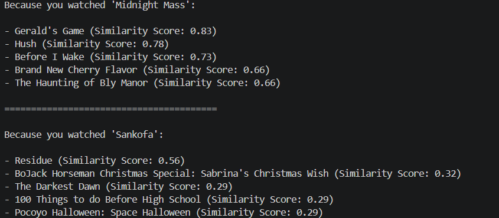

# Task 1: Netflix Content Recommendation System

## Objective

Build a content based recommender system which will recommend similar movies/TV shows on Netflix by analyzing their text metadata.

## Method

As there is no overview column, the recommender was created using the following columns:

1. **Data Preprocessing:**

- Remove any (`\r`) characters from the column names to avoid any key errors.
- Fill any missing values with (`''`) rather than `NaN`. This means the machine learning algorithm can run without error.

2. **Create new feature:** Combine the `director`, `country`, `rating`, and `listed_in` (genre) columns into one tag column.
3. **Vectorize text data using TF-IDF:** This will create a matrix of values from the text. This gives less weighting to common words such as 'Movies' and more weighting to uncommon words such as a specific directors name.
4. **Calculate cosine similarity:** This calculates the angle between the vectors. The closer to 1.0 the more similar the titles are.

## Results

The model was tested using two different titles.

**Success (Midnight Mass):** The algorithm found a good group of horror titles (*Gerald's Game*, *Hush*, *Before I Wake*). As the dataset had a high weighting on a unique identifier (Director: Mike Flanagan), the TF-IDF vectoriser grouped titles together with high similarity scores (~0.83).

**Limitations (Sankofa):** For titles with little metadata or a common director, the model will rely on the genre and country. This results in low similarity scores (~0.29-0.56).
### Fig: Task Result



## Conclusion

This content based recommender uses TF-IDF and Cosine Similarity to group content together. However, this experiment shows that if there is no rich text data such as plot summaries or user behavior (collaborative filtering), the metadata will be highly biased towards titles with a common director and genre.

## How to Run

Make sure you have the correct dependencies installed (`pandas`, `scikit-learn`).

Run the script using the terminal:

```bash

python task1_recommender.py
```


[def]: C:\Users\prade\Desktop\Netfilx\Images\Task1.png