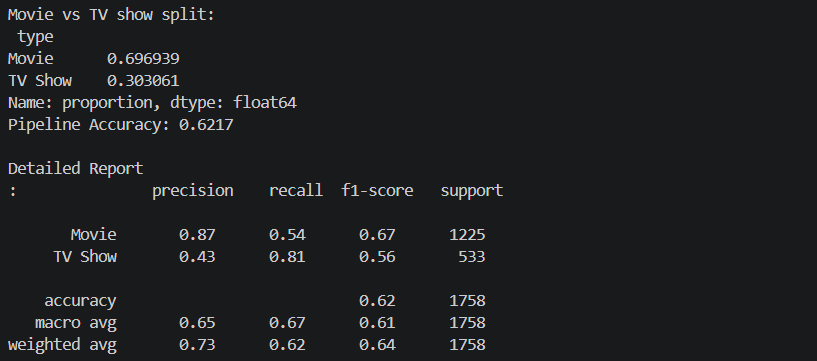

# Task 2 - Predicting Content Type
## Objective

To create a machine learning model that can predict whether a title on Netflix is a Movie or a TV Show. This experiment focused heavily on preventing data leakage.
## Method

1. Data Preprocessing and Loading
Used a custom Loader.py script to load our data. This script also converted the date_added values into a standard date format, extracted the year_added values from the date_added values and removed any invisible line breaks from the column names.
2. Feature Selection and Preventing Data Leakage
The duration column (which contains either min or Seasons depending on whether it is a Movie or TV Show) was removed as including this would cause data leakage. This would cause the accuracy of our model to be 100% as we are providing the model with the unit of measurement.
3. Categorical Variables
Converted any categorical variables into numeric values so they could be used in our machine learning model.
4. Training Model
Split our data into training and testing data.
Built and trained a Random Forest Classifier to predict the type of title using the remaining metadata.

## Results
Random Forest Classifier Accuracy - ~62%
Although this may look like a low accuracy, this is actually just an honest accuracy. It shows that it is very difficult to predict the format of a title using non-leaky metadata (such as the year it was released, date added and rating). As Netflix release both Movies and TV Shows at the same time for all age ratings.

## Conclusion
This task has shown how to create a classification pipeline. We have focused on following best practices within data science by ensuring that we do not have any data leakage.

### Fig: Task 2



## How to Run
Make sure you have the correct dependencies installed (pandas, scikit-learn).
Run the script using the command line:
```bash
python task2.py