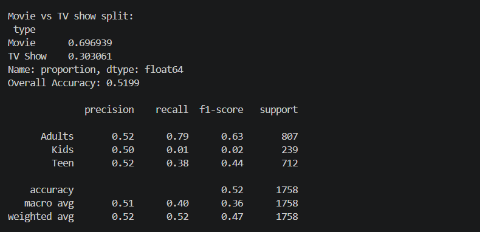

# Task 3: Audience Rating Classifier
## Objective

Build a machine learning model that can predict the target demographic for items on Netflix. This was done by firstly simplifying the detailed maturity ratings and then training a Decision Tree classifier.
## Method

1. **Data Handling / Cleaning :**
Data was handled and cleaned using a main script that I created called **Loader.py**
2. **Target Variable :**
The raw data had many detailed maturity ratings (TV-MA, R, PG-13, TV-Y). These were simplified into 3 categories (Kids, Teens, Adults) using mathematical equations.
3. **Features :**
The relevant metadata was chosen to train the model (Release year, Duration, Genre/Tags etc.)
Categorical text data was converted into numerical data.
4. **Decision Tree Classifier :**
The data was split into training and testing data.
A Decision Tree Classifier was trained.

## Results
The Decision Tree was able to produce a set of rules using nodes to help classify the data. The Decision Tree automatically decides which features are best to split the data. For example Animation genres and duration limits proved to be very useful.

## Conclusion
This task demonstrates how to simplify a complex and noisy target variable (Dozens of maturity ratings) into something useful for the business (Kids/Teens/Adults). The Decision Tree algorithm was a great choice for this problem as the logic behind it is very similar to how humans would make decisions.
### Fig: Task 3



## How to Run
Make sure you have installed the correct libraries (`pandas`, `scikit-learn`).
Run the script in terminal.
```bash
python task3.py