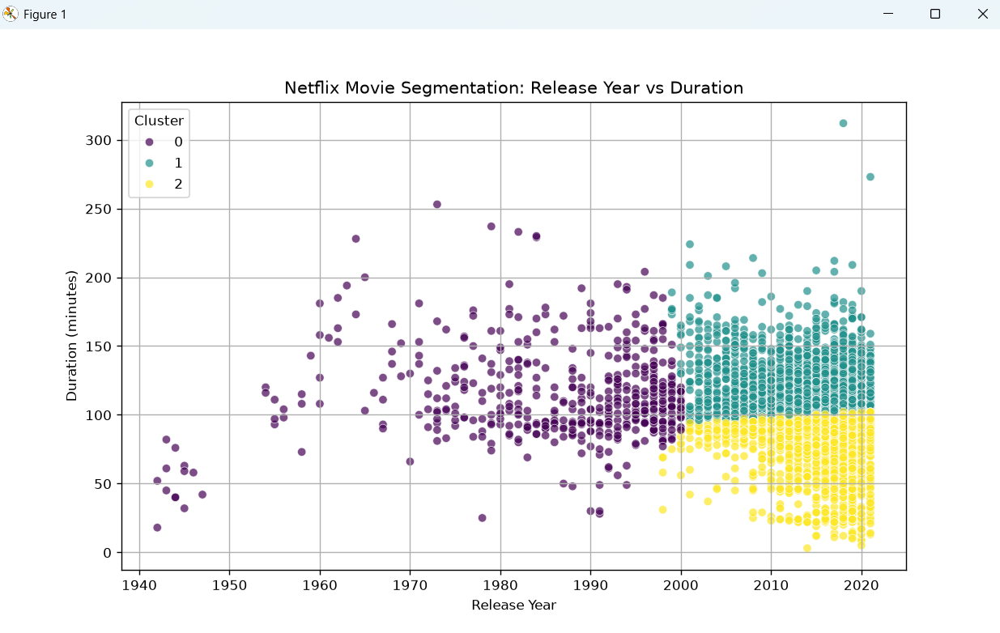
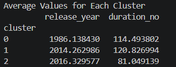

# Task 4: Netflix Content Segmentation

## Objective

The aim of this task is to use unsupervised machine learning to uncover patterns in Netflix's movie content. By grouping movies together using their release year and duration, we can find different time periods and formats of content.

## Implementation

1. **Data Preparation :**
   Filtered the data to only show "Movies" in the dataset to avoid the algorithm getting confused by the difference in duration between movies (minutes) and TV shows (seasons).
   Selected just the numerical columns: release_year and duration_no.
2. **Scaling :**
   Used StandardScaler to scale the numerical data. K-Means uses distance between variables so scaling the data means we treat the Year and Duration equally (e.g. 2020 vs 90).
3. **K-Means :**
   Used K-Means to find 3 different clusters (n_clusters = 3).

## Results

The K-Means algorithm has successfully separated the movies on Netflix into 3 categories. As seen by the mean values, we have:

**Cluster 0 - The Classics :** Older movies with a mean release year of 1986 and a mean duration of 114 minutes.

**Cluster 1 - Modern Feature Films :** Newer movies with a mean release year of 2014 and a mean duration of 121 minutes. These are typical modern blockbusters and full length dramas.

**Cluster 2 - Modern Short Content :** Very new movies with a mean release year of 2016 and a much shorter mean duration of 81 minutes. This shows visually and mathematically how there has been a recent increase in documentaries, stand up comedy and short animated films.

## Conclusion

This has shown how we can use unsupervised learning to audit our content. We can see mathematically how the Modern Feature Films and Modern Short Content have been separated. This shows how recent trends have moved to creating easier to consume short content.

### Fig: Task 4 graph



### Fig: Task 4



## How to Run

Make sure you have the correct dependencies installed (`pandas`, `scikit-learn`, `matplotlib`, `seaborn`).
Run the script in the terminal:

```bash
python task4.py
```
