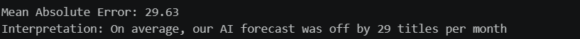
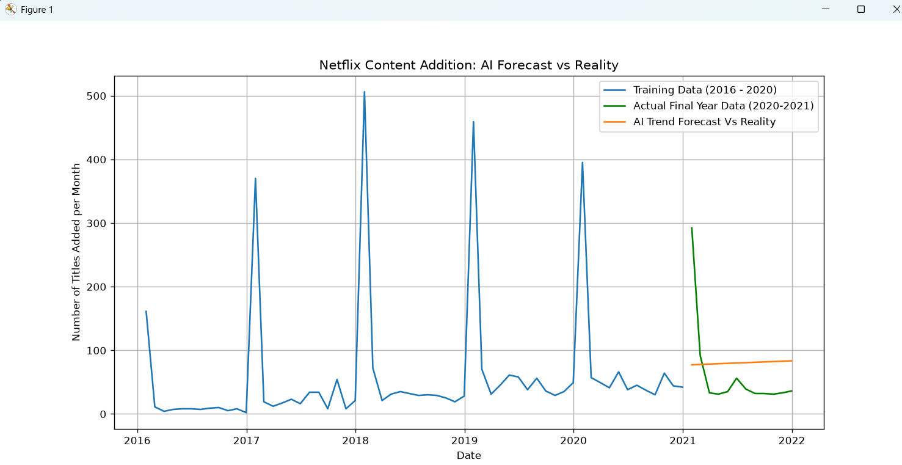

# Task 5: Netflix Trend Forecasting Model

## Objective
To create a time series forecasting model to predict how much content Netflix adds to their platform. We can look at the historical data to predict the trend.
## Method

1. **Data Cleaning & Time Series :**
Convert the *date_added* column into datetime objects and make it the index.
Group the data by month using .resample(`ME`).size()
Filter out any data before Jan 2016 to ensure that the early data does not distort our trend line.
2. **Train Test Split (Time Series) :**
As we are using time series data, we need to split the data in a time based manner. We trained our model using historical data (2016 to mid 2020). We tested using the last 12 months of data (Oct 2020 - Sept 2021).
3. **Exponential Smoothing :**
We created a forecasting model using the Holt-Winters Exponential Smoothing algorithm. This algorithm looks at the underlying trend and forecasts it using heavily weighted averages of recent data.

## Results
Model Accuracy (MAE)
Our model had a MAE of 29.63. This means our algorithm was only on average 29 titles out when forecasting one year ahead.
Trend
The AI was able to find a trend showing Netflix are increasing their content. This reflects how they are a very ambitious company and want to increase their original content.
Volatility
The real data for late 2020 and 2021 was very volatile. This reflects how there was a global pandemic which affected production schedules.

## Conclusion
This task was a complex time series task. We were able to create a solid baseline for our forecasting. Despite having some unprecedented disruptions in the historical data, our Exponential Smoothing model was able to give us a good insight into the general trend of the business.

### Fig: Task 5

### Fig: Visuals


## How To Run
Make sure you have the correct dependencies installed (`pandas`, `matplotlib`, `statsmodels`, `scikit-learn`).
Run the script in the terminal:
```bash
python task5_forecasting.py