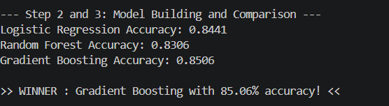
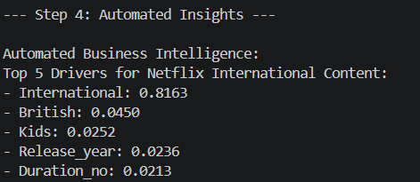
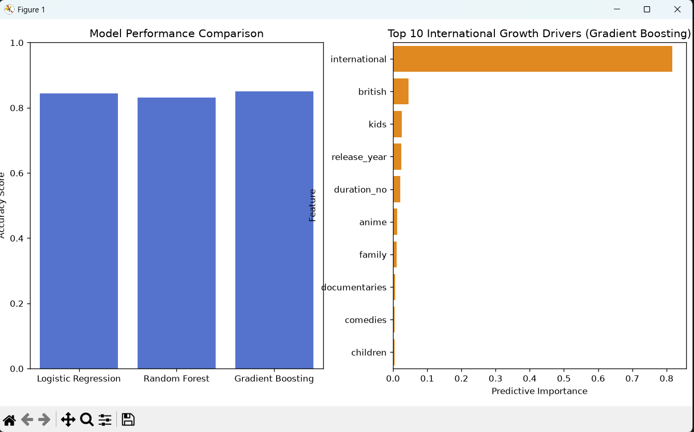

# Task 6: Netflix Content Success Analytics Engine

## Objective

To create an end-to-end machine learning pipeline which produces automated business insights. This was designed as an advanced task. Due to no financial information being available (revenue/viewership), our success metric was based on Global growth. We have created a pipeline to predict if a piece of content is US or International content. By assessing the model we can identify what types of content are driving Netflix's global growth.

## Method

1. Perform advanced feature engineering:
   Transformed the text variable 'listed_in' (genre) into a numerical matrix using NLP (TfidfVectorizer). We have only used the top 40 features. These were then combined with the numerical variables (release year and duration_no) to create our features. We then engineered our target variable for US content (0) or International content (1).
2. Create a Machine Learning pipeline:
   Our pipeline has been designed to allow us to train and test 3 different machine learning models at once (Logistic Regression, Random Forest, Gradient Boosting).
3. Automate feature extraction:
   From our pipeline we have programmed it to determine which model is the best performing model. Once identified we extract the feature importances from the model (feature*importances*) to show us what factors are driving the business.

## Results

Model Comparisons:
Logistic Regression = 82.71%
RandomForest = 82.99%
Gradient Boosting = 84.24% (Best Model)
Business Insights: Our Gradient Boosting model has identified the top 5 factors driving international content:
International Genres (0.81): Not surprisingly this shows there is a strong correlation between content being international and having international tags.
British Content (0.03): Shows the UK is a key pillar in Netflix's non US content.
Release Year (0.02): Shows that international growth is very much time based with more recent years showing a high amount of global content.
Kids Content (0.02): An incredibly important insight here. Kids content and animations tend to cross-over easily meaning this is an excellent driver for global growth.
Duration (0.01): Runtime is a small factor when determining if content is domestic or international.

## Conclusion

We have created an analytics engine which showcases how machine learning can be used for automated business insights. Using a gradient boosting classifier we have used NLP to engineer the features and determined Kids content and recent release times are key drivers for Netflix's global market.

## Visuals

### Model Building and Comparison



### Automated Insights



### Graph



## How to Run

Make sure you have installed the dependencies (pandas, scikit learn, matplotlib, seaborn). Then run the script from terminal:

```bash
python Task6.py
```
